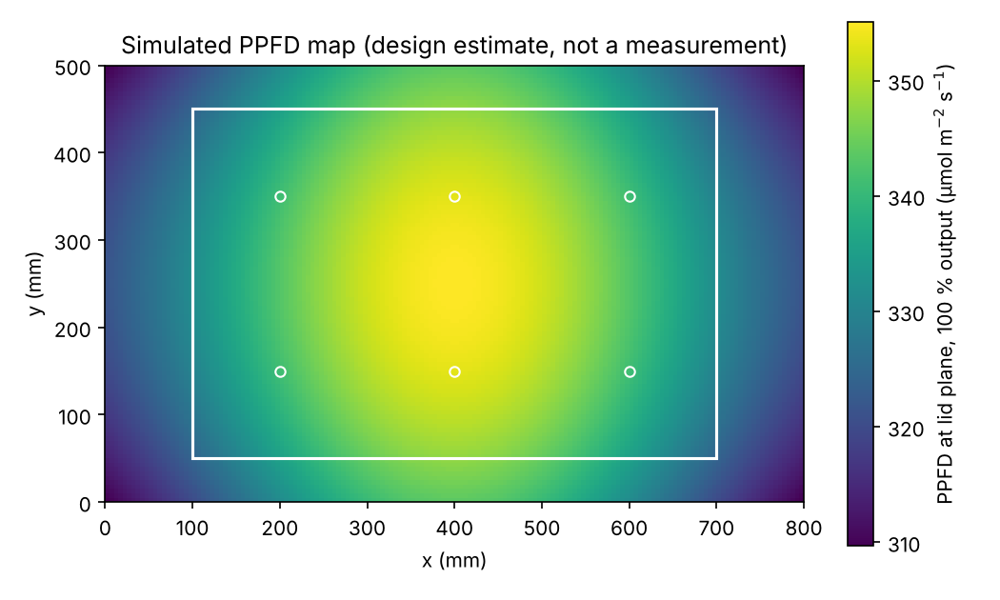

# Engineering calculation report

Generated by `python -m plantpulse.engineering.report` from `hardware/design_parameters.yaml`.
Do not edit by hand. Every value is a **design calculation**; none is a measurement.
Inputs flagged `verify` in the parameter file must be confirmed against datasheets, and
each result has a corresponding commissioning test in `docs/validation/validation_plan.md`.

## 1. Structural loading and deflection

| Quantity | Value | Note |
|---|---|---|
| Solution volume in tub | 28.1 L | at design depth |
| Solution mass | 28.1 kg |  |
| Tub + lid + plants + solution | 32.8 kg | mature crop |
| Tub cross-member deflection | 0.55 mm | L/910; limit L/250 |
| Tub cross-member bending stress | 14.6 MPa | SF on yield 10.0 |
| Wet pod mass | 60 kg | frame + panels + equipment + water |
| Lower-pod column load (upper pod on top) | 98 N | per column, 6 columns |
| Column Euler buckling load | 6068 N | SF 62 |
| Corner joint shear demand | 80 N | SF vs T-nut slip 6.2 |
| Top-up reservoir shelf deflection | 0.064 mm | 2020 cantilever pair |
| Camera arm tip deflection | 0.042 mm | static, payload + self weight |
| Camera arm root stress | 1.44 MPa |  |

## 2. Recirculation hydraulics

| Quantity | Value | Note |
|---|---|---|
| Required flow for target turnover | 1.87 L/min |  |
| Loss at required flow | 6.95 kPa | incl. static lift |
| Pump/system operating point | 2.97 L/min @ 1.35 m | generic pump curve - verify |
| Tube velocity / Reynolds number | 0.98 m/s / 7867 |  |
| Tub turnover at operating point | 6.3 per hour | margin x1.6; throttle with PWM |

## 3. Lighting

| Quantity | Value | Note |
|---|---|---|
| Photon flux of all strips at 700 mA | 223 umol/s | lm x PPF/klm conversion, thermally derated |
| LED + driver electrical power at 100 % | 84.4 W |  |
| System photon efficacy | 2.64 umol/J | incl. driver |
| Mean PPFD over 600x400 grow area at 100 % | 344 umol/m2/s | lid plane, simulated |
| PPFD at the six plant positions at 100 % | 340, 353, 341, 341, 353, 341 | umol/m2/s |
| Uniformity min/mean (plant positions) | 0.99 | requirement >= 0.80 |
| Uniformity min/max (plant positions) | 0.96 |  |
| Fraction of emitted photons landing on grow area | 0.37 |  |
| PWM duty for 250 umol/m2/s | 72 % |  |
| Electrical power at nominal PPFD | 61.2 W |  |
| DLI at nominal (16 h) | 14.4 mol/m2/d |  |
| Maximum DLI at 100 % (16 h) | 19.9 mol/m2/d |  |
| Lighting energy at nominal | 0.98 kWh/day | 27.4 kWh per 28-day cycle per pod |

## 4. Heat, moisture, CO2 and airflow

| Quantity | Value | Note |
|---|---|---|
| Exhaust fan operating flow (2 light traps) | 22.6 m3/h | 79 air changes/h |
| Wall conductance UA | 7.0 W/K |  |
| PAR radiant power entering chamber | 44.5 W | at maximum LED output |
| Sensible gain in chamber (lights on) | 36.6 W | PAR + window conduction + fans, less latent |
| Chamber rise above room, full ventilation | 2.5 K | lowest achievable day temperature = room + this |
| Chamber rise above room, minimum ventilation | 4.4 K | heater off |
| LED bay heat to reject | 39.9 W | electrical minus PAR transmitted |
| LED bay air temperature rise | 4.1 K | dedicated fan, room air |
| Heater power for 30 C in 20 C room (lights off, min vent) | 80 W | installed 100 W: margin x1.2 |
| Maximum sustainable setpoint with heater | 32.4 C | lights off, minimum ventilation |
| Peak crop transpiration (6 plants) | 56 g/h | assumption: 150 mL/plant/day in 16 h |
| Ventilation moisture removal capacity | 130 g/h | 23 C/70 % chamber vs 20 C/50 % room, full flow |
| RH floor at full ventilation, mature crop | 54 % |  |
| Humidifier duty for 70 % RH, empty chamber, min vent | 23 g/h | installed ~35 g/h |
| CO2 drawdown at full ventilation | 14 ppm | peak assimilation assumption |
| Minimum ventilation for < 100 ppm drawdown | 3.1 m3/h | sets the minimum fan duty |
| Mean air speed over canopy, mixing fan at 100 % | 1.70 m/s | jet estimate; run at ~29 % PWM for 0.5 m/s; measure with anemometer |

## 5. Imaging geometry and positioning accuracy

| Quantity | Value | Note |
|---|---|---|
| Field of view at lid plane | 524 x 393 mm | long axis across the two rows |
| Ground sample distance at lid | 0.129 mm/px | requirement <= 0.2 |
| GSD at 200 mm canopy height | 0.078 mm/px |  |
| Apparent area change for a leaf 200 mm above lid | +178 % | perspective; corrected with height estimate |
| Hyperfocal distance (f/8, CoC 3 px) | 974 mm |  |
| Depth of field | 275 - 617 mm from lens | must span canopy top to lid (300-500 mm) |
| Gantry resolution | 80 microsteps/mm (12.5 um) | GT2 20T, 1/16 microstepping |
| Station repeatability budget (RSS, 1 sigma) | 0.075 mm = 0.6 px | requirement <= 0.5 mm; residual removed by fiducial registration |
| Rail thermal growth for 10 K (600 mm travel) | 0.14 mm | systematic between temperature treatments; fiducials compensate |
| Motion-stereo depth resolution at 400 mm (60 mm baseline, 0.25 px) | 0.17 mm | theoretical; texture-limited in practice |
| Off-nadir angle at plant centre (row offset 100 mm) | 11.3 deg |  |

## 6. Electrical power

| Quantity | Value | Note |
|---|---|---|
| Rail 48V_LED per pod | peak 84.4 W / mean 40.8 W |  |
| Rail 24V_ACT per pod | peak 126.4 W / mean 33.0 W |  |
| Rail 24V_LOGIC per pod | peak 3.7 W / mean 3.7 W |  |
| Pod total (DC side) | peak 215 W / mean 78 W | control recipe, 20 C room |
| Facility at the wall (4 pods + central + air pump) | peak 967 W / mean 358 W | PSU efficiency 0.90 |
| Facility energy per 28-day cycle | 241 kWh | estimate; metered in operation |
| 24 V supply loading | 87 % | all heaters on simultaneously |
| 48 V supply loading | 56 % |  |
| Mains current at peak (120 V) | 8.1 A | 15 A GFCI circuit adequate |
| Fuse 48V_LED feed per pod | 1.76 A load -> 2 A fast blade fuse |  |
| Fuse 24V_ACT feed per pod | 5.27 A load -> 7.5 A blade fuse |  |
| Fuse 24V_LOGIC feed per pod | 0.15 A load -> 1 A blade fuse |  |
| Fuse Mains inlet | 8.1 A load -> 10 A slow-blow in IEC inlet |  |
| Voltage drop 48V_LED 3 m AWG18 | 0.22 V (0.5 %) |  |
| Voltage drop 24V_ACT 3 m AWG16 | 0.41 V (1.7 %) |  |
| Voltage drop 24V_LOGIC 3 m AWG20 | 0.03 V (0.1 %) |  |

### Load schedule (per pod)

| Load | Rail | Peak W | Typ. duty | Mean W | Note |
|---|---|---|---|---|---|
| LED strips via 3 x CC driver | 48V_LED | 84.4 | 0.483 | 40.81 | dimmed to nominal PPFD |
| PTC heater | 24V_ACT | 100.0 | 0.250 | 25.00 | duty depends on setpoint and room |
| Exhaust + mixing + LED-bay fans | 24V_ACT | 2.9 | 0.800 | 2.30 |  |
| Circulation pump | 24V_ACT | 5.0 | 1.000 | 5.00 |  |
| Peristaltic top-up pump | 24V_ACT | 5.0 | 0.010 | 0.05 |  |
| Humidifier | 24V_ACT | 2.5 | 0.200 | 0.50 |  |
| Gantry stepper | 24V_ACT | 6.0 | 0.020 | 0.12 | driver disabled between moves |
| Imaging LED ring | 24V_ACT | 5.0 | 0.005 | 0.03 |  |
| Node MCU + sensors | 24V_LOGIC | 1.2 | 1.000 | 1.20 |  |
| Camera node (Pi Zero 2 W + HQ cam) | 24V_LOGIC | 2.5 | 1.000 | 2.50 |  |

## Method notes and limits

- Beams: Euler-Bernoulli, joints idealised as pinned (conservative for deflection).
- Hydraulics: Darcy-Weisbach with Haaland friction factor; generic quadratic pump curve.
- Lighting: Lambertian point-source superposition with image-source wall reflections (2 bounces).
  PPF is derived from luminous flux with a literature conversion factor; expect +/- 10 %.
- Thermal: steady state, well-mixed chamber; fan curve linearised; light-trap loss coefficient estimated.
- Imaging: thin-lens model; positioning budget is root-sum-square of independent contributions.
